# 17. Wagbook for kennel owners

This guide is for the person who runs the kennel. You do not need to know anything about computers beyond using
WhatsApp. Everything here is done on a phone; a computer works too.

Wagbook replaces the register book, the sticky notes and the "who fed Bruno?" messages. It keeps every booking, every
pet's food and medicines, every bill and every payment in one place your whole team can see.

The pictures are from the demo kennel, with invented pets and parents.

## Before you start

Someone sets Wagbook up once ([10-setup-and-deploy.md](10-setup-and-deploy.md) has every step). After that you get an
address, such as `book.yourkennel.in`. Open it on your phone, and use your browser's menu to "Add to Home screen". It
then opens like an app.

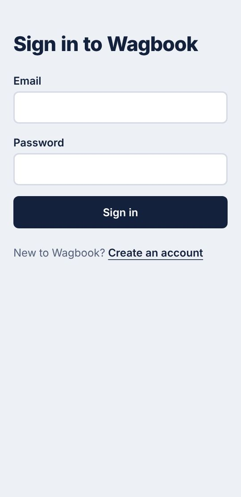

Create your account with your email and a password, open the email Wagbook sends you, and sign in. Wagbook asks three
things: the kennel's name, a short name for its links (`happy-tails`), and your own name. Then it asks how many kennels
(rooms, runs, cages) you have, and numbers them for you.

### Five minutes of setting up

Under **More**:

1. **Settings**: your phone and WhatsApp number, address, check-in and check-out times, and your UPI ID so parents can
   pay by scanning a code. If you charge GST, your GSTIN and state.
2. **Settings, prices**: what one night of boarding and one day of day boarding cost.
3. **Daily routines**: the meals and cleaning every pet in the house gets (breakfast at 9, dinner at 6).
4. **People**: make an invitation link for each person on your team, and send it on WhatsApp. Choose **staff** for
   people who look after the pets, **manager** for people who also handle prices, bills and settings.
5. **Two-step sign-in**: turn it on for yourself (see "Keeping it safe" below).

You can change all of this later.

## Every morning: Today

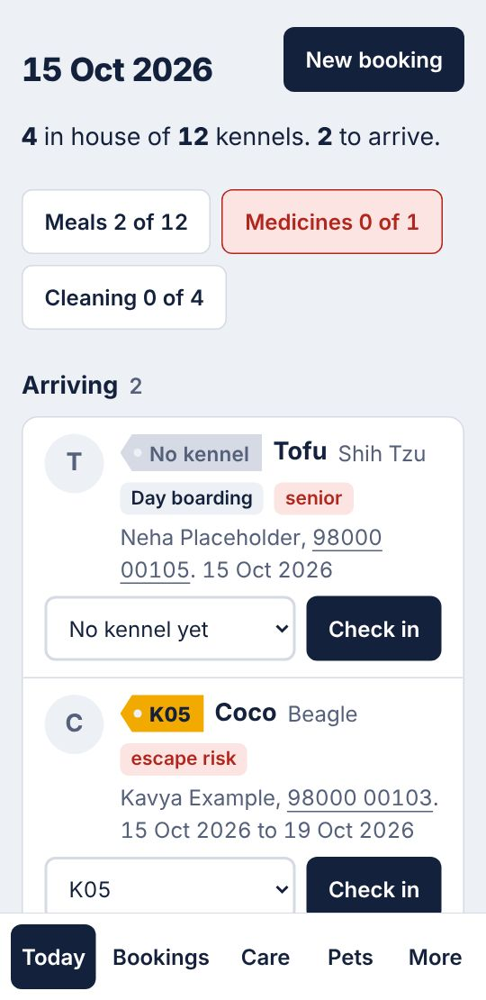

**Today** is the first screen. At the top: how many pets are in, out of how many kennels. Below it, how much of the
day's care is done (meals, medicines, cleaning); red means something is waiting. Then who is **arriving**, who is
**going home**, and who is in the house.

When a pet arrives, choose its kennel and press **Check in**. Wagbook asks you to confirm you have seen the vaccination
certificates and to note what came with the pet (a bed, a lead, food).

Red tags on a pet (escape risk, bites, reacts to other dogs) are there so nobody misses them.

## Taking a booking

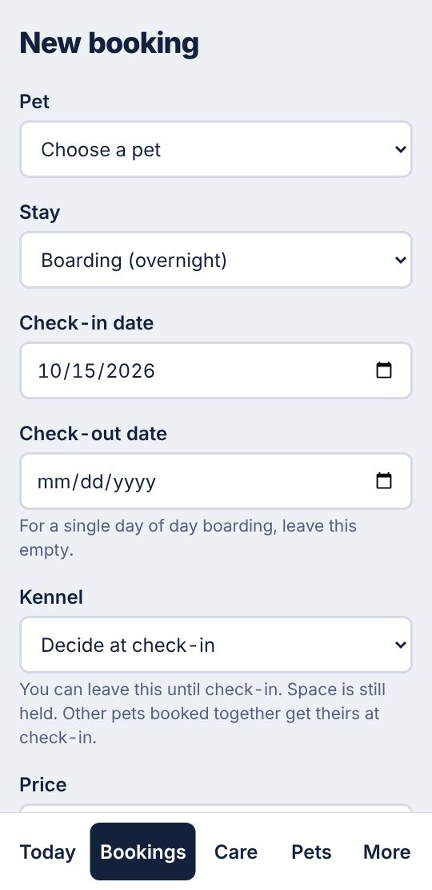

Press **New booking** on Today. Choose the pet (or add a new one with its parent), the dates, and a kennel if you know
it. Wagbook will not let two pets share a kennel on the same night, and will not let you take more pets than you have
kennels. If something clashes, it tells you in a sentence what and when.

Two pets of one family can be booked together, in a kennel each or in one kennel, the second at your shared kennel
price. If one goes home early, the nights the other has the kennel to itself are billed at your usual price. A booking
can also start as a **request**, which holds no kennel until you confirm it.

Every booking has its own page:

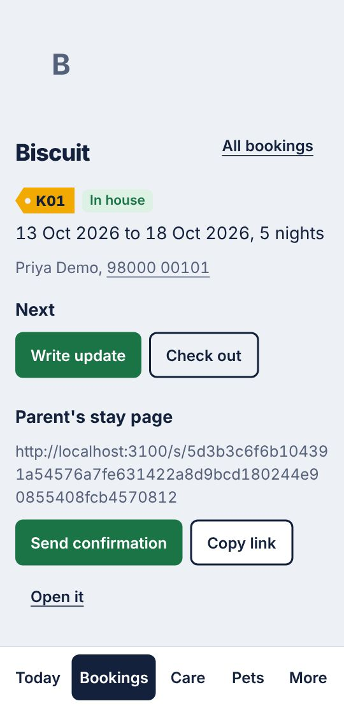

From here you check the pet in and out, write updates for the parent, add extras (a bath, a pick-up), and send the
parent their link. If a pet in day boarding stays the night after all, an owner or manager uses **Staying overnight**:
the days so far stay day boarding, and the nights are boarding, each at its own price on the bill.

## The care round

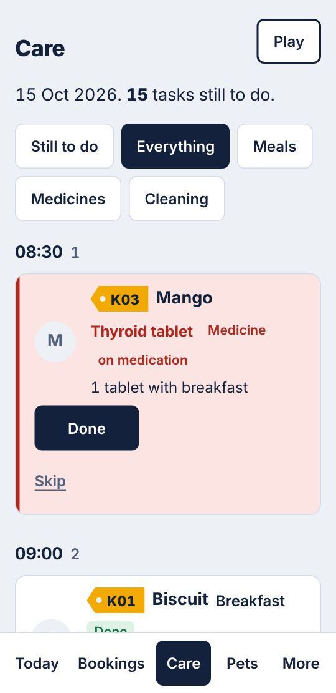

**Care** lists everything to do today, by time: meals, medicines, cleaning, walks. One tap on **Done** records who did
it and when. Tapping twice by mistake changes nothing. A medicine that is skipped needs a reason, because the parent and
the next shift need to know.

If the phone loses its connection, ticks are kept on the phone and sent when it is back.

**Play** (top right) plans solo play in your yards, one pet at a time, so dogs that should not meet never do.

## Pets and parents

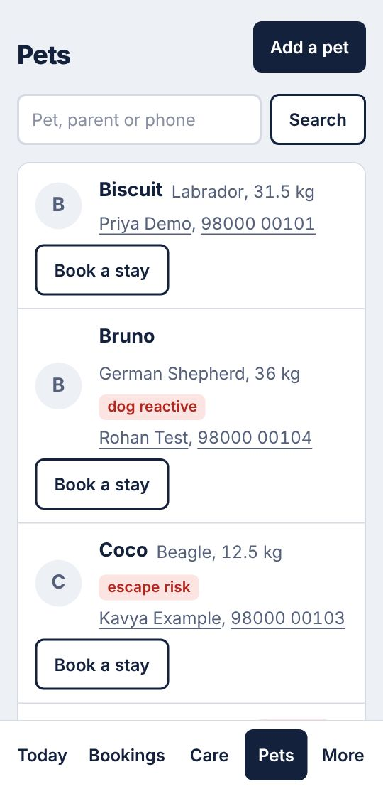

**Pets** finds any pet by its name, its parent's name or a phone number. A pet's page has its photo, food, health,
vaccinations (with a warning when one has run out or will run out during a stay), incidents and stays. Anyone on the
team can keep these up to date. A parent's phone numbers are changed only by an owner or manager, because a wrong
number sends their updates and bills to someone else.

### The form parents fill in

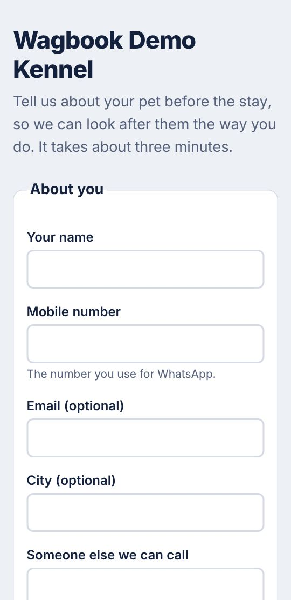

Under **More, Forms from parents** is your form's link. Send it to a new parent before the first stay: they type in
their pet's food, health, behaviour and vaccinations themselves, and can attach a photo of the vaccination card. Their
answers wait for you to check:

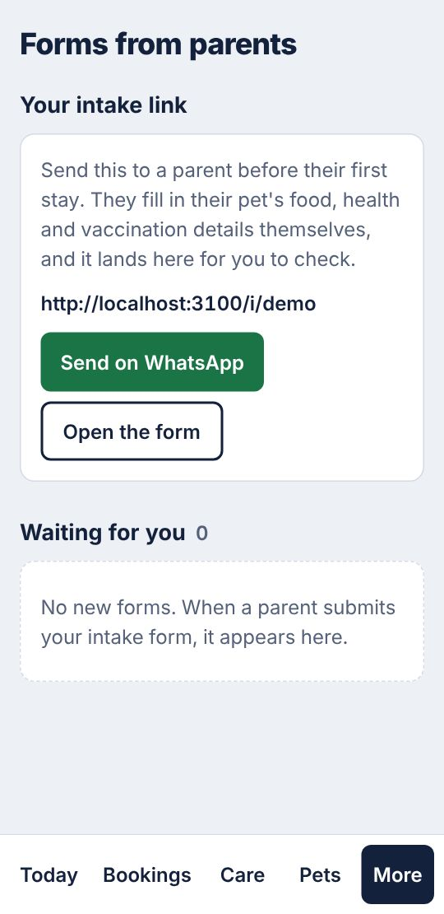

**Accept and book** adds the parent and pet and opens a new booking with their dates. A parent you already know is
recognised by their phone number, and their details are never overwritten by a form.

### What parents see

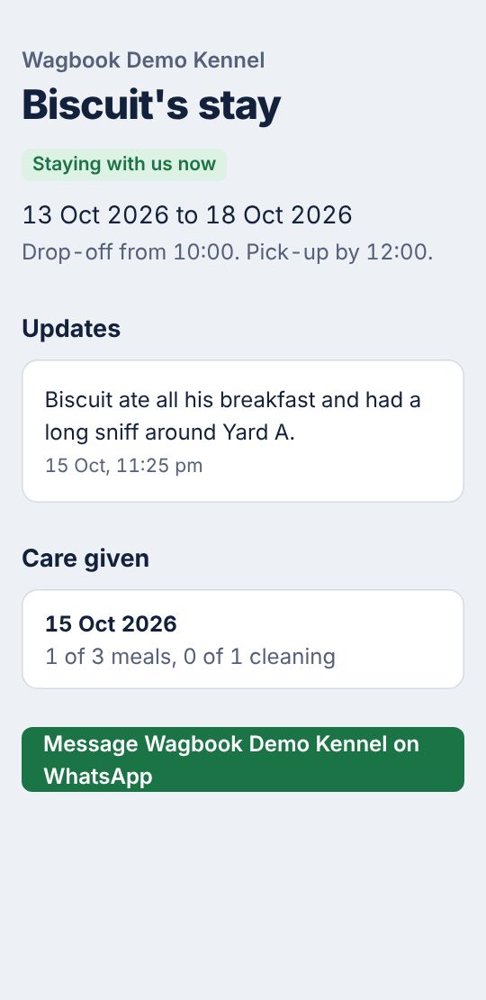

Each stay has a private page for the parent: the dates, your updates and photos, and how much of the care was done.
No account, no app: you send the link from your own WhatsApp. It stops working a month after the pet goes home.

## Money

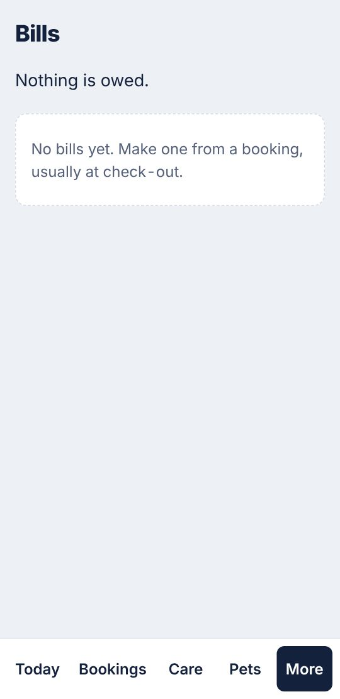

When a pet goes home, **Make bill** on the booking fills in the nights and extras at your prices. **Issue bill** gives it its
number (numbers follow on, with no gaps, as tax law expects). Send it on WhatsApp: the parent's page has a QR code that
opens their UPI app with the amount filled in. When the money arrives, **Record payment**. An advance taken at booking
counts towards the bill.

An issued bill cannot be changed by anyone. If it is wrong, cancel it (with a reason) and make a new one.

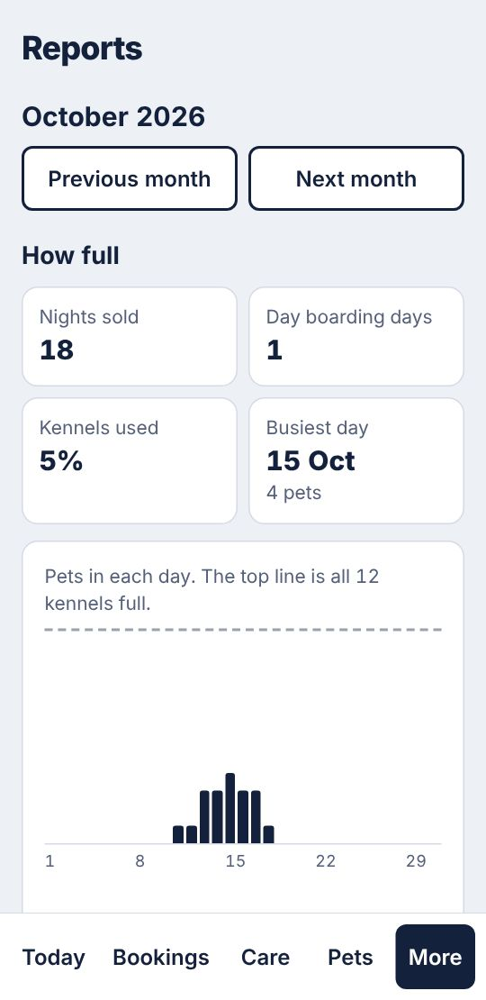

**More, Reports** (owners and managers) shows how full you were each day, money in and out by month, tax by rate, and
which extras sell. **Expenses** is where you note what the kennel spent, with a photo of the receipt. Everything can be
downloaded for your accountant.

**More, History of changes** shows who changed a booking, a price, a bill or a setting, and when.

## Keeping it safe

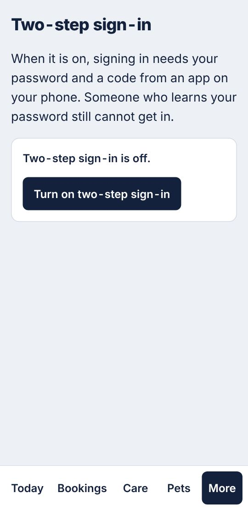

- **Turn on two-step sign-in** (More, Two-step sign-in). Install an authenticator app on your phone (Google
  Authenticator or Microsoft Authenticator), scan the picture Wagbook shows, and type the code. From then on, signing
  in needs your password and a code from the app, so a stolen password is not enough. Ask your managers to do the same.
- **Give each person their own account.** Never share the owner's password. When someone leaves, open **More, People**
  and suspend them.
- **Shared phone at the kennel?** Sign out at the end of the shift (More, Sign out).
- **Backups.** Whoever set Wagbook up should take regular copies (see
  [15-backup-and-restore.md](15-backup-and-restore.md)). Ask them when they last did.

## When a parent asks about their details

India's data protection law lets a parent ask what you hold about them, and ask you to delete it. On the parent's page
(open a pet, then its parent), owners and managers find **What we hold about them** (only an owner can erase):

- **Download their details** gives you one file with everything. Send it to the parent.
- **Erase their details** empties their name, phone numbers, address and notes, and deletes the updates you sent
  them, their forms and the vaccination cards (a card shows the owner's name). Their pets' records stay, hidden: the
  pet's details, photo, vaccinations, routines and incidents. Bills you already issued stay, because tax law requires
  you to keep them.
  This cannot be undone, so Wagbook asks you to tick a box first. It is refused while their pet is still with you or a
  stay is booked.

## Languages

Each person chooses the language Wagbook speaks to them under **More**: English, Hindi or Kannada. Under **Settings**
you choose the language of the pages and messages parents get. Bills are always in English; if a parent asks, choose
**Bills: English and हिन्दी** (or ಕನ್ನಡ) on their page, and the headings of their bills show in that language too, in
brackets.

## Getting help

- Something does not work: open an issue on the project's GitHub page, with a screenshot (never a parent's real
  details).
- You think someone could see what they should not: do not post it publicly; see `SECURITY.md`.
- An idea: describe the problem at the kennel, not the screen you imagine. "Staff forget the evening tablet" is the
  best kind of idea.
